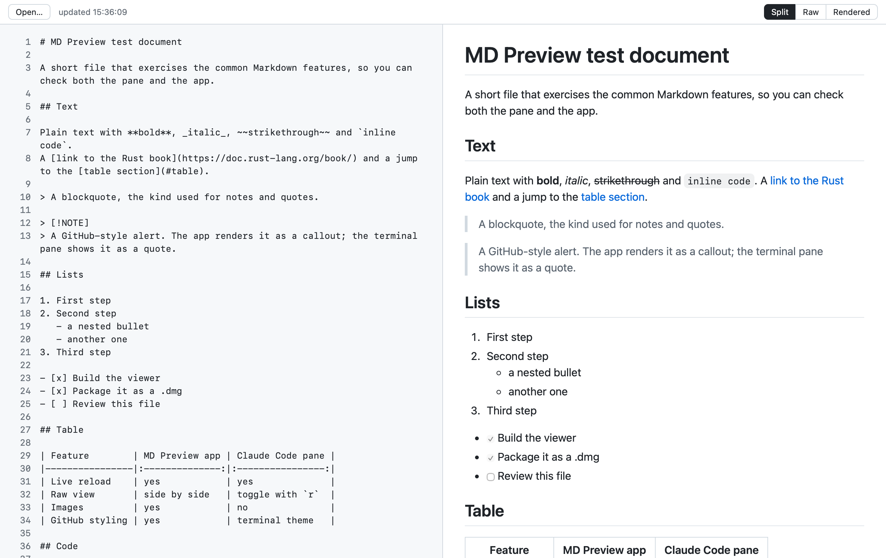

<p align="center"></p>

<h1 align="center">MD Preview</h1>

A tiny native Markdown viewer and editor for macOS: source and rendered output side by side, with live preview and live reload.

<picture>
  <source media="(prefers-color-scheme: dark)" srcset="docs/screenshot-dark.png">
  
</picture>

## Features

- Split, Raw or Rendered view (`⌘1` / `⌘2` / `⌘3`)
- Edit the source with live preview; `⌘S` to save
- Reloads automatically when the file changes on disk
- GitHub-flavored Markdown with syntax highlighting, light and dark mode
- Open files by drag and drop, `⌘O`, the command line, or Finder

## Install

Open `dist/MD-Preview.dmg` and drag **MD Preview** into Applications. The first time, right-click the app and choose **Open**.

## Build

Requires Rust and the Xcode command line tools.

```sh
cargo run -- path/to/file.md   # run
./build-dmg.sh                 # build dist/MD-Preview.dmg
```

## License

[MIT](LICENSE)
